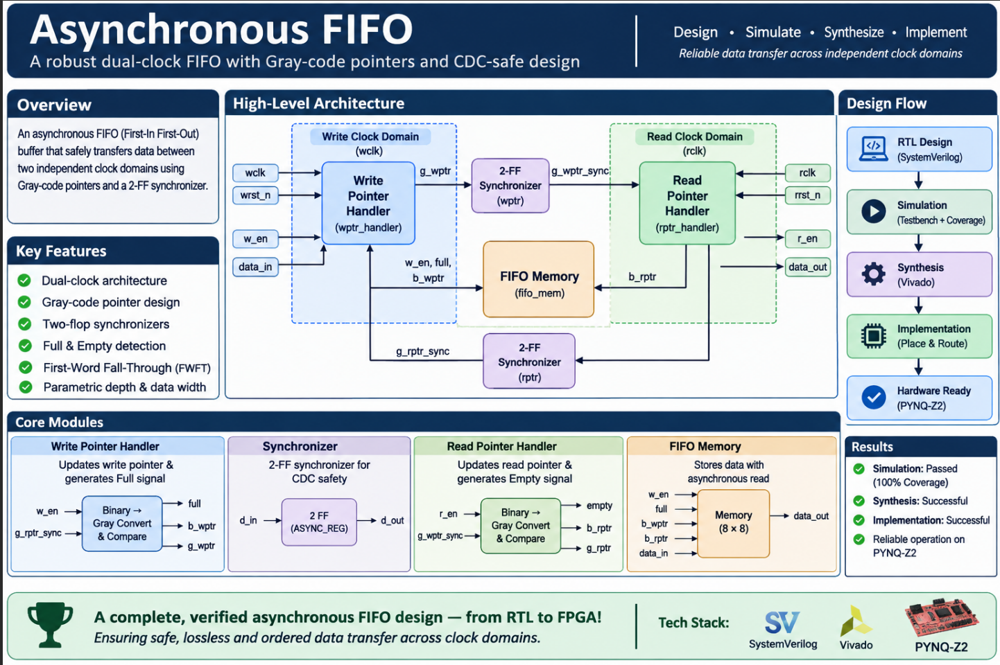

# Asynchronous FIFO — SystemVerilog RTL

A parameterized, dual-clock **Asynchronous FIFO** in SystemVerilog, using Gray-code pointers and two-flop synchronizers for safe data transfer between independent clock domains.

The project focuses on **Clock Domain Crossing (CDC)**, pointer synchronization, FIFO control logic, and asynchronous buffering. The design was simulated, synthesized, and implemented with AMD Vivado.

---

## Table of Contents

1. [Features](#features)
2. [Specifications](#specifications)
3. [Architecture](#architecture)
4. [Module Overview](#module-overview)
5. [CDC Concepts](#cdc-concepts)
6. [Pointer Logic](#pointer-logic)
7. [FIFO Memory and FWFT](#fifo-memory-and-fwft)
8. [Verification](#verification)
9. [Synthesis and Implementation](#synthesis-and-implementation)
10. [Project Status](#project-status)
11. [Key Learnings](#key-learnings)
12. [Tools](#tools)

---

## Features

- Independent write clock (`wclk`) and read clock (`rclk`)
- Parameterized depth and data width (depth must be a power of two, minimum 4)
- Gray-coded pointers with two-flop synchronizers (`ASYNC_REG` attributed)
- Registered `full` and `empty` flags
- First-Word Fall-Through (FWFT) read behaviour
- Self-checking testbench with assertions and functional coverage

---

## Specifications

| Parameter | Configuration |
|---|---|
| HDL | SystemVerilog |
| Architecture | Asynchronous (dual-clock) FIFO |
| Default depth | 8 entries |
| Default data width | 8 bits |
| Pointer width | 4 bits (3 address bits + 1 wrap bit) |
| Pointer encoding | Binary (memory addressing) and Gray (CDC) |
| CDC mechanism | Two-flop synchronizers |
| Read architecture | First-Word Fall-Through (FWFT) |
| Simulator | Vivado XSim |
| FPGA tool | AMD Vivado 2026.1 |
| Intended platform | PYNQ-Z2 |

---

## Architecture



*Independent clock domains, pointer handlers, synchronizers, and shared FIFO memory.*

### Write path

1. The write interface receives `data_in` and `w_en`.
2. The write pointer handler checks `full`.
3. If not full, data is stored at the current write address.
4. The binary write pointer advances and is converted to Gray code.
5. The Gray write pointer is synchronized into the read clock domain.

### Read path

1. The read interface checks `empty`.
2. If not empty and `r_en` is asserted, the read pointer advances.
3. `data_out` reflects the entry at the current read address.
4. The binary read pointer is converted to Gray code.
5. The Gray read pointer is synchronized into the write clock domain.

### Synchronization paths

```text
Write domain (wclk)                          Read domain (rclk)

g_wptr ──────────► 2-FF sync (rclk) ──────► g_wptr_sync ──► rptr_handler (empty)
g_rptr_sync ◄───── 2-FF sync (wclk) ◄────── g_rptr  ◄────── rptr_handler
     │
     └──► wptr_handler (full)
```

---

## Module Overview

| Module | Responsibility |
|---|---|
| `asynchronous_fifo` | Top-level integration |
| `wptr_handler` | Write pointer generation, Gray conversion, `full` detection |
| `rptr_handler` | Read pointer generation, Gray conversion, `empty` detection |
| `synchronizer` | Two-stage pointer synchronizer |
| `fifo_mem` | Dual-clock storage with asynchronous read |

---

## CDC Concepts

### Metastability

A flip-flop that samples an input changing too close to its clock edge can enter a temporarily unstable state. With unrelated clocks there is no guaranteed phase relationship, so this risk is unavoidable. It cannot be eliminated, but the probability of it propagating into downstream logic can be reduced with a proper synchronizer.

### Two-flop synchronizer

```systemverilog
(* ASYNC_REG = "TRUE" *) logic [WIDTH-1:0] q1;
(* ASYNC_REG = "TRUE" *) logic [WIDTH-1:0] q2;

always_ff @(posedge clk or negedge rst_n) begin
    if (!rst_n) begin
        q1 <= '0;
        q2 <= '0;
    end else begin
        q1 <= d_in;
        q2 <= q1;
    end
end

assign d_out = q2;
```

- `q1` captures the asynchronous input and may go metastable.
- `q2` gives `q1` an extra clock period to settle and drives the destination domain.
- `ASYNC_REG` tells Vivado these registers form a synchronizer chain, aiding placement.

> **Note:** A two-flop synchronizer does **not** make arbitrary multi-bit buses safe. This design relies on Gray-coded pointers, where only one bit changes per increment.

### Why Gray code?

A binary increment can flip many bits at once (`0111 → 1000` flips all four). If sampled mid-transition across clock domains, the destination may see an inconsistent value. In Gray code, consecutive values differ by exactly one bit.

| Binary | Gray |
|---|---|
| 000 | 000 |
| 001 | 001 |
| 010 | 011 |
| 011 | 010 |
| 100 | 110 |
| 101 | 111 |
| 110 | 101 |
| 111 | 100 |

Conversion: `G = B ^ (B >> 1)`

```systemverilog
assign g_wptr_next = (b_wptr_next >> 1) ^ b_wptr_next;
```

The read pointer uses the same conversion.

---

## Pointer Logic

Pointers are **one bit wider** than the memory address. For depth 8, the address is 3 bits and the pointer is 4 bits; the extra MSB distinguishes wraparound (full vs. empty). In the snippets below, `PTR_WIDTH` refers to the address width, so full pointers span `[PTR_WIDTH:0]`.

### Write side (`wptr_handler`)

- Advances only when `w_en && !full`
- Generates the next binary pointer, converts it to Gray, and registers `full`

**Full detection** compares the next Gray write pointer against the synchronized read pointer with its two MSBs inverted:

```systemverilog
assign wfull =
    (g_wptr_next ==
     {~g_rptr_sync[PTR_WIDTH:PTR_WIDTH-1],
       g_rptr_sync[PTR_WIDTH-2:0]});
```

This indicates the write pointer is a full FIFO depth ahead of the read pointer.

### Read side (`rptr_handler`)

- Advances only when `r_en && !empty`
- Generates the next binary pointer, converts it to Gray, and registers `empty`

**Empty detection** compares the next Gray read pointer against the synchronized write pointer:

```systemverilog
assign rempty = (g_wptr_sync == g_rptr_next);
```

### Why use *next* pointers?

Flags are computed from next-pointer values so they can be registered and update in step with pointer advancement.

---

## FIFO Memory and FWFT

```systemverilog
logic [DATA_WIDTH-1:0] mem [0:DEPTH-1];

always_ff @(posedge wclk) begin
    if (w_en && !full)
        mem[b_wptr[PTR_WIDTH-1:0]] <= data_in;
end

assign data_out = mem[b_rptr[PTR_WIDTH-1:0]];
```

- Writes happen on the rising edge of `wclk`, addressed by the lower bits of the binary write pointer, and are blocked while `full`.
- Reads are asynchronous, addressed by the lower bits of the binary read pointer.
- **FWFT:** the head entry is visible on `data_out` without a read-data register. Treat `data_out` as valid whenever `empty == 1'b0`. Asserting `r_en` advances to the next entry.

---

## Verification

A SystemVerilog testbench was run in Vivado XSim. Scenarios covered:

- Independent write and read clocks, with different frequency ratios
- Reset behaviour, including reset during active traffic
- Single write/read transactions and back-to-back transfers
- Filling until full and attempting writes while full
- Draining until empty and attempting reads while empty
- Randomized post-reset transactions
- Data-order checking
- Assertions on key pointer and FIFO behaviours, plus functional coverage

### Results

| Metric | Result |
|---|---:|
| FIFO depth | 8 |
| Data width | 8 bits |
| Accepted writes | 2,175 |
| Accepted reads | 2,169 |
| Writes blocked while full | 2,035 |
| Reads blocked while empty | 1,947 |
| Maximum occupancy | 8 / 8 |
| Write functional coverage | 100% |
| Read functional coverage | 100% |
| Overall functional coverage | 100% |
| Testbench result | **PASSED** |

```text
*** TEST PASSED ***
```

> **Scope note:** 100% functional coverage means every bin defined in this testbench was hit. It does not imply exhaustive verification of all input sequences or CDC timing scenarios.

---

## Synthesis and Implementation

Completed in Vivado: RTL design → functional simulation → RTL synthesis → implementation.

**Recommended further checks:**

- Inferred memory resources and LUT / FF / memory utilization
- Setup and hold timing reports
- Vivado CDC analysis
- Synchronizer placement and Gray-pointer bus timing constraints
- Reset assertion and synchronized reset deassertion in both clock domains

Physical validation on the PYNQ-Z2 is a separate step and is only complete once tested on the programmed board.

---

## Project Status

| Stage | Status |
|---|---|
| RTL development | Completed |
| Functional simulation | Passed |
| Functional coverage | 100% |
| Synthesis | Completed |
| Implementation | Completed |
| Timing and CDC report review | To be documented |
| Physical PYNQ-Z2 validation | Pending |

---

## Key Learnings

- **CDC:** why independent clocks cause metastability, how two-flop synchronizers work, and why multi-bit bus synchronization is unsafe
- **Gray code:** binary-to-Gray conversion and why single-bit transitions suit pointer crossing
- **FIFO control:** pointer wraparound, full/empty detection, overflow and underflow prevention
- **RTL and verification:** parameterized modules, multi-clock simulation, assertions, functional coverage, and the Vivado flow

---

## Tools

- SystemVerilog
- AMD Vivado 2026.1 and Vivado XSim
- PYNQ-Z2 (target platform)

---

*The goal was not just to build a FIFO, but to understand how reliable data transfer is designed across independent clock domains.*